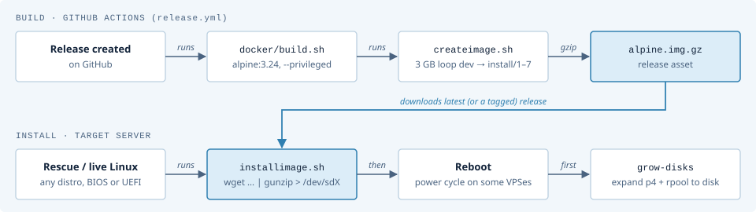
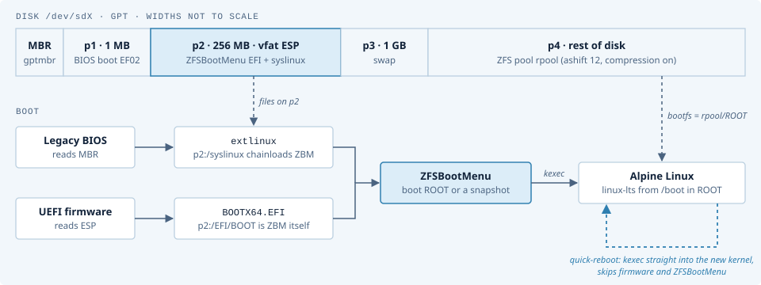
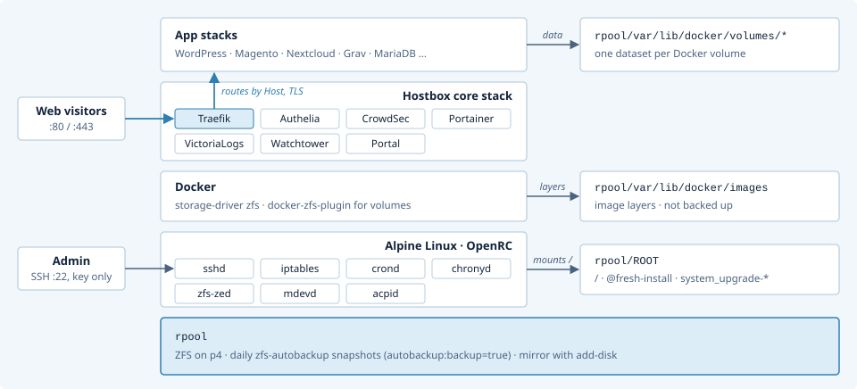
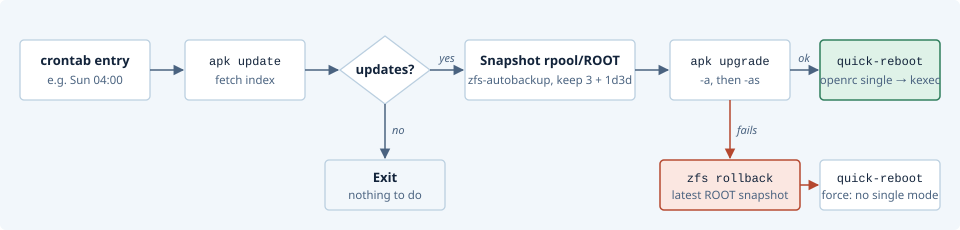

**Climb high, roll back safely.**

This is an quick-installer for [Alpine Linux](https://www.alpinelinux.org/) with ZFS as root filesystem, and [ZFSBootMenu](https://docs.zfsbootmenu.org/) to boot into different environments.

* Fastest and easiest way to install Alpine on ZFS.
* Uses the excellent [ZFS](https://openzfs.org/wiki/Main_Page) filesystem.
* [ZFSBootMenu](https://docs.zfsbootmenu.org/) as bootloader, which allows you to roll back in case of failed upgrades.
* After installing it can boot in both BIOS mode and UEFI mode.
* Optional [automatic updates](#automatic-updates): snapshot, upgrade, and a fast kexec "quick reboot". The system rolls back automatically if the upgrade fails.
* Optional "batteries included" hosting server with [Hostbox](https://github.com/psy0rz/portainer-templates): one script (`./install-portainer-stack`) gives you a complete, ready-to-use setup to host many websites and web applications on one server:
  * [Portainer](https://www.portainer.io/) web GUI with ready-made app templates (WordPress, Magento, Nextcloud and more).
  * [Traefik](https://traefik.io/) reverse proxy with automatic SSL certificates from Let's Encrypt or ZeroSSL.
  * [Authelia](https://www.authelia.com/) login (optionally two-factor) for all admin interfaces.
  * [CrowdSec](https://www.crowdsec.net/) and a global blocklist to keep out bots and attackers.
  * Logs in VictoriaLogs, and nightly automatic image updates with Watchtower.
  * Every Docker volume is a ZFS dataset, with snapshots and replication backups by [zfs-autobackup](https://github.com/psy0rz/zfs_autobackup).
  * A minimal firewall that does not interfere with Docker.

  Refer to [Installing Docker or Hostbox](#installing-docker-or-hostbox).
* Also easy to install at VPS providers that do not provide an Alpine installer.
* Install time is about 1 minute.

To see how it all fits together (image build, disk layout, boot chain, the running server and the automatic upgrades), refer to the diagrams in [Architecture](#architecture).

## Why Alpine Linux?

Alpine is one of the best and cleanest Linux distros out there, for running Docker and various other stuff. Packages like the Linux kernel, ZFS support and Docker are not only very up to date, but also very stable.

It's super small, fast and simple. It's not the most versatile distribution, but what it does, it does very well.

Also upgrading to newer releases is quick and painless, in contrast to other distros. And since we use snapshots before upgrading, it's easy to roll back should there be a problem.

For this reason all our boxes run Alpine and just auto-upgrade and reboot every week without problems.

# Installing

To install Alpinebox, you write a ready-made disk image to the disk of the system. You do this from a Linux environment that you boot from a different medium, for example a live USB drive or the rescue system of a VPS provider.

The image is a complete Alpinebox system. It contains Alpine Linux, the ZFS root pool and ZFSBootMenu. The imager script downloads the latest release from [GitHub](https://github.com/psy0rz/alpinebox/releases) and writes it directly to the disk. You do not have to partition the disk or configure the system.

**CAUTION: THE IMAGER DELETES ALL DATA ON THE DISK THAT YOU SPECIFY.**

1. Boot a Linux distribution from a CD or a USB drive. If you use a VPS provider, use its rescue boot. Refer to [VPS provider tips](VPS-PROVIDERS.md).

   The boot mode of this Linux distribution (UEFI or legacy) is not important. The image contains the two boot modes and always boots. You can also change between UEFI and legacy boot after the installation.

2. Download the imager:
   ```
   # wget https://boot.datux.nl/image
   ```
   *NOTE: This URL goes to https://raw.githubusercontent.com/psy0rz/alpinebox/master/install/installimage.sh*

3. Start the imager. Specify your hard disk:
   ```
   # bash image /dev/sda
   ```
   The imager downloads the image and writes it to the disk. The installation is then complete.

   The imager installs the latest release. To install a different release, specify the release tag from the [releases page](https://github.com/psy0rz/alpinebox/releases):
   ```
   # bash image /dev/sda <release>
   ```

4. Reboot the system. Some VPS providers need a power cycle.

If you have problems during the installation, refer to [VPS provider tips](VPS-PROVIDERS.md).

## Login

Console logins do not have a root password.

SSH password logins are disabled. Thus, a root password does not give SSH access. To log in with SSH, add your public key to `/root/.ssh/authorized_keys`. This file exists, but it is empty after the installation.

To add your key, do one of these procedures:

* Log in on the console and add the key to `/root/.ssh/authorized_keys`.
* Before you reboot after the installation, import the pool from the rescue system and add the key:
  ```
  # zpool import -R /mnt rpool
  # cat my-key.pub >> /mnt/root/.ssh/authorized_keys
  # zpool export rpool
  ```

## Growing the disk

**CAUTION: DO THIS PROCEDURE IMMEDIATELY AFTER THE INSTALLATION. THIS PROCEDURE CAN CAUSE DAMAGE TO THE DATA ON THE DISK.**

The image has a fixed size. Thus, you must increase the size of the partition and the ZFS disk.

Run the `grow-disks` script in /root/alpinebox. The script does this procedure automatically. You do not have to reboot.

## Adding a disk

To add a disk to the zpool as a mirror, run the `add-disk` script in /root/alpinebox.

The script also partitions the disk and installs MBR, UEFI and ZFSBootMenu on it. If the first disk fails, you can then boot from this disk.

Before you add the disk, remove all disks that are not ONLINE from the pool.

## Prompt colour

The colour of the shell prompt shows the role of the server. You set the role with `DTAP_ROLE` in `/etc/profile.d/z_dtap-prompt.sh`:

| `DTAP_ROLE`       | Colour |
|-------------------|--------|
| `dev`             | Green  |
| `test`            | Yellow |
| `acc`             | Yellow |
| `prod` (default)  | Red    |

The change applies at the next login.

## GPU drivers

The installer blocks the common GPU drivers (radeon, amdgpu, nouveau, nvidia, i915 and drm), because they cause boot problems on older hardware. The list is in `/etc/modprobe.d/blacklist-gpu.conf`.

If you need a GPU, for example for video transcoding in a container, remove the driver from this file and reboot.

## Backups

Alpinebox uses my other project, [zfs-autobackup](https://github.com/psy0rz/zfs_autobackup), for snapshots and backups with ZFS replication.

To install it, run `./install-zfs-autobackup` in /root/alpinebox. The `install-portainer-stack` script also runs this script. The script does these steps:

1. It installs zfs-autobackup with pipx in `/root/.local/bin`.
2. It sets the property `autobackup:backup=true` on `rpool`. All datasets get this property, except `rpool/var/lib/docker/images`.
3. It adds the daily job `/etc/periodic/daily/zfs-autobackup`. This job makes a snapshot of the selected datasets each day.

The daily job makes only local snapshots. To copy the snapshots to a backup server, run zfs-autobackup on the backup server in pull mode. For example:
```
# zfs-autobackup -v --ssh-source <alpinebox-host> backup <target-dataset>
```
The backup server must have SSH access to the Alpinebox as root. Refer to the [zfs-autobackup documentation](https://github.com/psy0rz/zfs_autobackup) for more information.

## Updates

Before you do Alpine upgrades manually, make a snapshot. For example: `zfs snapshot rpool/ROOT@upgrades1`

If the upgrade fails, use ZFSBootMenu to roll back to the snapshot.

### Automatic updates

The `auto-update` script in /root/alpinebox does the upgrade procedure automatically. The script does these steps:

1. It updates the package index. If there are no new packages, the script stops.
2. It makes a snapshot of rpool/ROOT with [zfs-autobackup](https://github.com/psy0rz/zfs_autobackup). It keeps the 3 latest snapshots, and one snapshot each day for 3 days.
3. It upgrades all packages.
4. If the upgrade is successful, it does a quick reboot into the new system.
5. If the upgrade fails, it rolls back rpool/ROOT to the snapshot and does a quick reboot.

**NOTE: The snapshot contains only rpool/ROOT. The script does not roll back other datasets, for example your Docker data.**

To run the script manually:
```
# /root/alpinebox/auto-update
```

To run the script each week, add a cron job. Run `crontab -e` and add this line:
```
0 4 * * 0 /root/alpinebox/auto-update >> /var/log/auto-update.log 2>&1
```
This line runs the script each Sunday at 04:00. The crond service is enabled by default.

If the system does not boot correctly after an upgrade, use ZFSBootMenu to roll back to the latest `system_upgrade-...` snapshot.

### Quick reboot

The `auto-update` script uses the `quick-reboot` script to restart the system. This script does not do a full reboot. It uses [kexec](https://en.wikipedia.org/wiki/Kexec) to load the new kernel directly from the running system. Thus, the BIOS or UEFI firmware, the hardware checks and ZFSBootMenu are skipped. On physical servers this makes the reboot much faster, because these servers often need minutes for the firmware.

The `quick-reboot` script does these steps:

1. It changes the system to single user mode. This stops all services correctly.
2. It loads the kernel and the initramfs from /boot.
3. It starts the new kernel.

If kexec fails, the script does a usual reboot.

You can also use `quick-reboot` manually:
```
# /root/alpinebox/quick-reboot
```

**NOTE: On older Alpineboxes, kexec is not enabled. To enable it, run these commands:**
```
# zfs set org.zfsbootmenu:commandline="loglevel=4 kexec_load_disabled=0" rpool/ROOT
# apk add kexec-tools
```

### Upgrading to a new Alpine release

The `auto-update` script installs the updates of the Alpine release in `/etc/apk/repositories`, for example 3.23. To move to a new release, for example 3.24, change the release in this file. The `auto-update` script then does the upgrade, with the snapshot and the rollback.

If the system does not boot or does not work correctly, use ZFSBootMenu to roll back to the latest `system_upgrade-...` snapshot.

**CAUTION: DO NOT RUN `zpool upgrade` AFTER THE UPGRADE. ZFSBOOTMENU HAS ITS OWN ZFS VERSION. IF THE POOL USES ZFS FEATURES THAT ZFSBOOTMENU DOES NOT KNOW, THE SYSTEM DOES NOT BOOT.**

## Updating the Alpinebox scripts

/root/alpinebox is a git clone of this repository. To get the latest scripts, run these commands:
```
# cd /root/alpinebox
# git pull origin master
```

# Installing Docker or Hostbox

After you install Alpinebox, go to /root/alpinebox. This directory contains these install scripts:

* `./install-docker`: Installs Docker and the ZFS volume plugin.
* `./install-portainer`: Installs Docker and downloads [Hostbox](#hostbox).
* `./install-portainer-stack`: Installs Docker, Hostbox, zfs-autobackup and the [firewall](#installing-the-firewall).

When the script is complete, it shows the subsequent steps.

## Docker settings

The `install-docker` script configures Docker with these settings:

* **Images**: Docker uses the ZFS storage driver. The images are in `rpool/var/lib/docker/images`. This dataset is not backed up.
* **Volumes**: The Docker ZFS volume plugin creates a ZFS dataset for each volume in `rpool/var/lib/docker/volumes`. Thus, you can snapshot, back up and move each volume separately. The volumes have atime off.
* **Logs**: Each container keeps a maximum of 2 log files of 1 MB.
* **Networks**: Docker networks get a /24 subnet from `172.19.0.0/16`. If your LAN or VPN uses addresses in this range, change `default-address-pools` in `/etc/docker/daemon.json`.
* **DNS**: Containers use `ndots:1`.
* **sysctl**: `/etc/sysctl.d/docker.conf` sets `vm.max_map_count=1024000` for Elasticsearch and OpenSearch, and `fs.inotify.max_user_instances=1024`.

## Hostbox

[Hostbox](https://github.com/psy0rz/portainer-templates) turns one Docker server into a hosting platform for many websites and web applications. You create the sites in Portainer from a set of app templates. Each site runs in its own stack. Each Docker volume is a ZFS dataset, so you can snapshot it, back it up and move it to a different server.

The `install-portainer` script clones Hostbox to /root/portainer-templates and creates the `.env` file.

The core stack contains these components:

* **Traefik**: The reverse proxy. It gets free SSL certificates from Let's Encrypt or ZeroSSL, and blocks paths that scanners look for.
* **Portainer**: The Docker web GUI. You use it to create stacks from the templates.
* **Authelia**: The login portal for all admin interfaces, also for Portainer.
* **CrowdSec**: It finds attacks in the logs and bans the IP addresses of the attackers on all sites. It also uses the CrowdSec community blocklist. A web UI shows the alerts and bans.
* **VictoriaLogs**: It keeps the Traefik logs for 30 days.
* **Watchtower**: It updates the images each night.
* **Portal**: It shows the server manager overview page, and the blocked and maintenance pages.

To complete the installation:

1. Go to /root/portainer-templates/core/.
2. Edit the `.env` file. Set `DOMAIN` and the Let's Encrypt or ZeroSSL settings. `DOMAIN` must be a host name, not an IP address.
3. Run `./setup.sh`. Type the admin password when the script asks for it.

   The script creates the secrets, starts the stack, and configures Portainer to use the Authelia login and the app templates.
4. Go to `https://<DOMAIN>/server-manager/` and log in as `admin`. This overview page shows all admin interfaces: Portainer, the Traefik dashboard, the logs and the CrowdSec web UI.
5. In Portainer, click "Login with OAuth". Go to App templates and create a stack.

To change the admin password, run `./setup.sh` again.

These templates are available:

* WordPress (vanilla and LiteSpeed)
* Grav CMS
* Magento 2
* Symfony (LiteSpeed)
* Nextcloud
* Shared MariaDB and phpMyAdmin
* MikoPBX
* MailChannels relay

To move a stack and its ZFS volumes to a different server, use zmigrate.

For more information, for example two-factor login, CrowdSec and the maintenance pages, refer to the [Hostbox README](https://github.com/psy0rz/portainer-templates).

# Installing the firewall

Go to /root/alpinebox and run `./install-firewall`.

This script installs a minimal firewall. The firewall accepts SSH connections only from trusted IP addresses. These addresses are in the ipsets `admins-ipv4` and `admins-ipv6`. The firewall does not interfere with Docker.

**CAUTION: THE FIREWALL STARTS AFTER THE NEXT REBOOT. IF YOUR IP ADDRESS IS NOT IN THE IPSET THEN, YOU CANNOT LOG IN WITH SSH.**

After the script is complete, do these steps:

1. Add your IP address or network to the ipset:
   ```
   # ipset add admins-ipv4 192.168.13.0/24
   ```
   For IPv6 addresses, use `admins-ipv6`.
2. Save the ipsets to disk:
   ```
   # /etc/init.d/ipset save
   ```
   The ipsets are saved in /etc/ipset.d/. They load again at boot.
3. Reboot once to start the firewall.

To add more addresses later, do steps 1 and 2 again. You do not have to reboot.

**CAUTION: DO NOT RESTART IPTABLES AFTER DOCKER HAS STARTED. A RESTART REMOVES THE IPTABLES RULES OF DOCKER.**

# Architecture

This section shows how Alpinebox works: how the image is built, how the disk boots, what runs on a finished server, and how the server upgrades and rolls back by itself.

## From release to running disk



When a release is created on GitHub, GitHub Actions builds the disk image:

1. `devtools/docker/build.sh` starts a privileged `alpine` container.
2. In the container, `devtools/createimage.sh` creates a 3 GB loop device.
3. `createimage.sh` runs the install scripts `install/1-prepare.sh` to `install/7-cleanup.sh` on the loop device. Step 7 makes the snapshot `rpool/ROOT@fresh-install`.
4. The workflow compresses the image and uploads it as the release asset `alpine.img.gz`.

To test an image locally, run `devtools/runimage.sh <image>`. This script boots the image in QEMU. The default image is `/tmp/alpine.img`.

On the target server, `installimage.sh` downloads this image and writes it directly to the disk. Thus, every server gets the same tested image.

## Disk layout and boot chain



The disk has a GPT partition table with four partitions:

| Partition | Size         | Contents                                         |
|-----------|--------------|--------------------------------------------------|
| p1        | 1 MB         | BIOS boot partition                              |
| p2        | 256 MB       | EFI system partition with ZFSBootMenu and syslinux |
| p3        | 1 GB         | Swap                                             |
| p4        | Rest of disk | ZFS pool `rpool`                                 |

The two boot modes start the same ZFSBootMenu on p2:

* **Legacy BIOS**: The MBR (`gptmbr.bin`) starts extlinux on p2, because p2 has the legacy-bootable attribute. Extlinux then starts ZFSBootMenu.
* **UEFI**: The firmware starts `EFI/BOOT/BOOTX64.EFI` on p2. This file is ZFSBootMenu.

ZFSBootMenu boots `rpool/ROOT` or a snapshot of it. It loads the Alpine kernel from `/boot` in `rpool/ROOT` with kexec. It reads the kernel command line from the ZFS property `org.zfsbootmenu:commandline` on `rpool/ROOT`.

The `quick-reboot` script uses kexec to start the new kernel directly from the running system. This skips the firmware and ZFSBootMenu.

The `add-disk` script does the partitioning and the boot loader installation again on a second disk. It then attaches p4 of that disk to `rpool` as a mirror. Thus, the server can boot from each of the two disks.

## A running Hostbox server



A server with Hostbox has these layers, from bottom to top:

1. **rpool**: The ZFS pool on p4. `zfs-autobackup` makes a snapshot of all datasets each day (if you installed it, refer to [Backups](#backups)).
2. **Alpine Linux**: OpenRC starts the system services, for example sshd, iptables, crond and chronyd.
3. **Docker**: Docker uses the ZFS storage driver for images. The Docker ZFS volume plugin creates a ZFS dataset for each volume.
4. **Hostbox core stack**: Traefik, Authelia, CrowdSec, Portainer, VictoriaLogs, Watchtower and the portal.
5. **App stacks**: The sites that you create from the Portainer templates.

Each type of data has its own ZFS dataset:

| Dataset                          | Contents                     | Backup |
|----------------------------------|------------------------------|--------|
| `rpool/ROOT`                     | The root file system         | Yes    |
| `rpool/var/lib/docker/images`    | Docker image layers          | No     |
| `rpool/var/lib/docker/volumes/*` | One dataset per Docker volume | Yes    |

Thus, you can snapshot, back up and move each volume separately.

Traffic goes into the server like this:

* Web traffic on ports 80 and 443 goes to Traefik. Traefik routes each request to the correct app stack by its host name. Authelia protects all admin interfaces.
* SSH on port 22 is accepted only from the IP addresses in the `admins-ipv4` and `admins-ipv6` ipsets. The firewall drops all other new incoming connections.

## Automatic upgrade with rollback



The `auto-update` script does these steps:

1. It runs `apk update`. If there are no new packages, it stops.
2. It makes a snapshot of `rpool/ROOT` with `zfs-autobackup`.
3. It runs `apk upgrade`.
4. If the upgrade is successful, it runs `quick-reboot`.
5. If the upgrade fails, it rolls back `rpool/ROOT` to the latest snapshot. It then runs `quick-reboot force`.

**NOTE: The rollback applies only to `rpool/ROOT`. Docker images, volumes and other datasets are not rolled back.**

If the new kernel does not boot, use ZFSBootMenu to boot the latest `system_upgrade-...` snapshot.

## Post-install scripts

Each script in /root/alpinebox runs the scripts that it needs. Thus, run only the script at the top that you need:

```
install-portainer-stack
├─ install-portainer          (downloads Hostbox)
│  └─ install-docker
│     └─ install-docker-zfs-plugin
├─ install-zfs-autobackup     (daily snapshots)
└─ install-firewall           (iptables and ipset)
```
